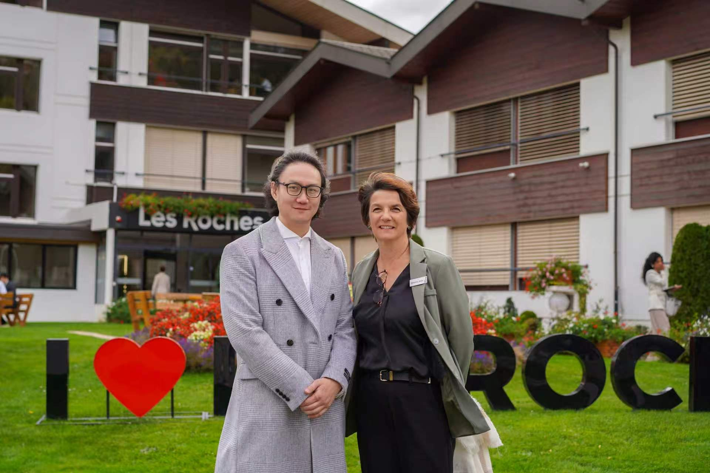

**A school name is not the whole scholarship story. The degree and the country in which you will study matter too.**

This is an important detail for Saudi applicants interested in Glion or Les Roches. Both are recognised names in hospitality education, and both have Swiss roots. But their international study options mean that two offers bearing the same school brand may describe quite different experiences.

If you plan to use the Saudi **Excellence Track**, LEP can help you clarify the Swiss study route before your application gains momentum.

## Why does Saudi scholarship eligibility depend on campus?

The Saudi Ministry of Education lists **Glion** and **Les Roches** in its [additional university list for hospitality management](https://www.moe.gov.sa/ar/education/higher-education/additional-unis). Its published [Excellence Track conditions](https://moe.gov.sa/ar/education/study-abroad/scholarship) also refer to an eligible specialisation, a direct unconditional offer and study in the country of the institution's main location.

For that reason, a strong application starts with more than a recognisable university name. It identifies:

- The **actual degree** and specialisation printed on the admission documents.
- The campus where the student is expected to study and the country in which it is located.
- Whether the course includes an experiential year, another campus or an international transfer option.
- The programme start date and the current scholarship application window.

LEP can coordinate these details with the school, helping students ask precise questions before paying school charges or making travel plans.

## Glion and Les Roches: which Swiss locations are relevant?

| School | Swiss setting to discuss | The question LEP will raise with admissions |
|---|---|---|
| **Glion Institute of Higher Education** | Glion and Bulle, with the programme stage determining the study arrangement | Which Swiss locations and study stages are included in the proposed International Hospitality Business bachelor? |
| **Les Roches Global Hospitality Education** | Crans-Montana | Is the proposed Global Hospitality Management degree arranged for Crans-Montana, and what international-campus options are built into the course? |

Glion also has a **London** education route. Les Roches describes bachelor options in **Crans-Montana, Marbella and Abu Dhabi**, including possible international campus transfers. A student's preferred lifestyle and a specific government-funding route may point towards different decisions; good planning looks at both before the application is submitted.

We discuss the 2027 campus and academic structure with the relevant admissions contact rather than treating a broad university listing as an answer to every programme question.

## What about preparatory years, internships and campus transfers?

Hospitality degrees often combine practical education, academic study and work placements. These features are valuable, but they can make a scholarship application more detailed than a single-campus classroom degree.

For example, an applicant might need to ask:

1. Does the initial offer identify a preparatory or experiential stage, and how is it connected to the bachelor's degree?
2. Does the formal letter name the Swiss campus and degree clearly?
3. If the school offers time at another international campus, how will that be recorded in the study plan?
4. Which programme and location details are needed for the Saudi scholarship application?

These questions should be resolved **while the student still has flexibility to choose the best route**. LEP helps gather the programme information and structure the discussion with the school.

## We have inspected the Swiss campuses in person

<figure class="article-photo"><figcaption>James Liu visiting Glion in Switzerland and discussing the student experience with hosts and students.</figcaption></figure>

<figure class="article-photo"><figcaption>James Liu on site at Les Roches, Crans-Montana, Switzerland.</figcaption></figure>

I visited both institutions in October 2026. At Glion, I looked at the different settings in which students learn and live. At Les Roches, I explored the Swiss campus and discussed practical training and student support.

When I advise an international family, I want the admissions plan to reflect a real place—not merely a logo and a ranking. For a Saudi scholarship applicant, that first-hand perspective becomes even more useful because **the exact place of study belongs in the funding conversation**.

## Ask LEP to check your Swiss-campus application route

Tell us your preferred school, degree, campus, planned intake and whether you already have an offer. LEP can help align the programme details with your admissions documents and the information you need to review for the Saudi scholarship application.

Our school application support includes **programme selection, school liaison, documentation and follow-up**. For the partner-school applications we handle, **schools pay for LEP's application support; students pay no additional LEP service fee**. School tuition, application fees and third-party expenses are separate.

**Email:** [contact@luxedupartners.lu](mailto:contact@luxedupartners.lu?subject=Saudi%20Scholarship%20%E2%80%93%20Swiss%20Campus%20Check) (subject: *Saudi Scholarship – Swiss Campus Check*)  
**WhatsApp:** [Discuss your Swiss-campus plan with LEP](https://wa.me/352661221289)

If you are still choosing the institution, see [which Saudi students can apply to Glion or Les Roches](/en/insights/saudi-students-glion-les-roches-scholarship-eligibility/). If you already need a formal offer, see [LEP's unconditional-offer application guide](/en/insights/unconditional-glion-les-roches-offer-saudi-scholarship/).

