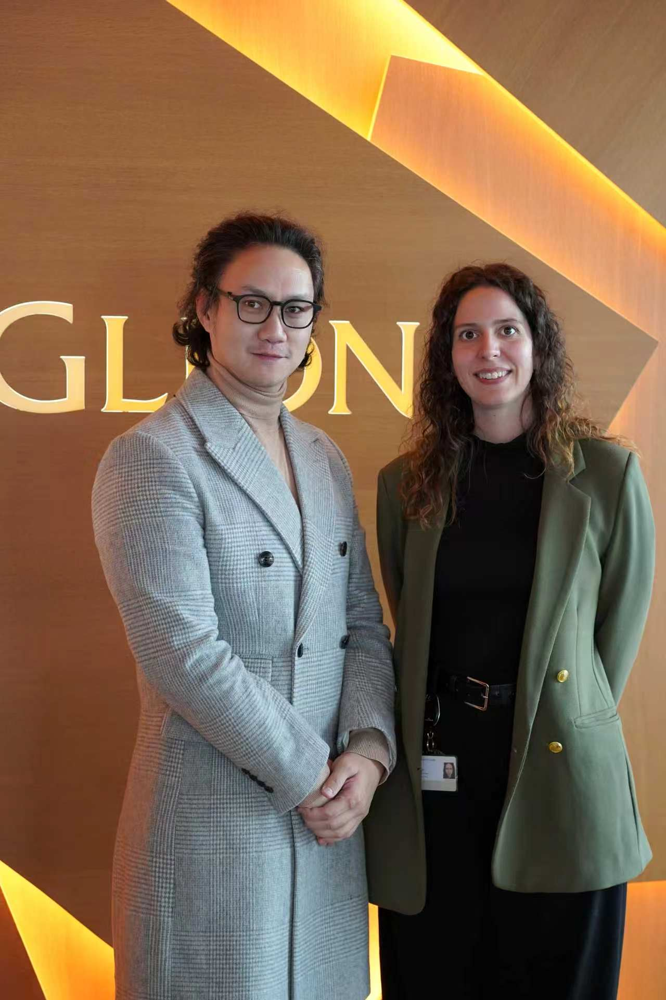

**An unconditional offer is often the document that makes the difference between having a plan to study abroad and being ready to submit a Saudi scholarship application.**

You might already know that you want Glion or Les Roches. You may even have an offer in your inbox. Yet something is holding up the next step: a diploma still to arrive, an English-language question, a requested assessment or a letter that does not clearly identify the degree and intake.

This is where working with **Lux Education Partners (LEP)** becomes practical. We help you address the school-side issues one by one, directly and in the right order.

## Why does the Saudi Excellence Track ask for an unconditional offer?

The Saudi Ministry of Education's published [Excellence Track rules](https://moe.gov.sa/ar/education/study-abroad/scholarship) require a **direct, unconditional acceptance** into an eligible institution and specialisation for a qualifying degree. The official letter is expected to identify the institution, the specialisation and the programme start date.

That makes the distinction between types of offers important:

| Document or situation | Your next useful action |
|---|---|
| Initial admissions enquiry | Ask the school to assess your intended degree and entry qualifications. |
| Application submitted but documents outstanding | Obtain the exact missing-document list and an orderly submission sequence. |
| Conditional offer | Identify each remaining condition, its evidence and the expected review timing. |
| Formal unconditional offer | Review the degree, campus and intake details against the scholarship requirements. |

LEP can help manage this progression. Rather than focusing on the label *offer*, we focus on what the school actually needs to issue the document relevant to your plan.

## Five things LEP can do to move your application forward

**1. Assess your starting position.** We review your education, transcripts, English evidence, intended qualification and target intake. If you already have a conditional offer, we start there.

**2. Speak to the relevant admissions team.** We help clarify the applicable Glion or Les Roches programme, the Swiss campus and the school's requested documents. This is especially useful when your background does not fit a simple checkbox—for example, a Saudi national studying at a UK college.

**3. Prepare and submit a coherent application.** Academic records, identity documents, motivation and any requested supporting evidence need to tell a consistent story. We coordinate the process and follow up as it moves through assessment.

**4. Work through the offer conditions.** We help you create a short action list: what is outstanding, who is preparing it, when it can be submitted and what admissions needs to review next.

**5. Prepare the offer for the scholarship stage.** Once the appropriate formal letter is available, we help check that the school, programme, campus and start-date details are clearly recorded for the next part of the process.

These are not abstract consulting activities. They are the actual emails, documents, decisions and follow-ups that keep an application moving.

<figure class="article-photo"><figcaption>James Liu on his October 2026 visit to Glion in Switzerland. LEP combines first-hand campus knowledge with application liaison.</figcaption></figure>

## What if your IELTS score is 5.5?

Glion currently publishes an IELTS requirement of **5.5 overall, with at least 5.0 in every component**, for applicants who need to provide an English test for its Swiss International Hospitality Business bachelor route. It also specifies a certificate timing requirement and describes cases involving recent English-medium schooling.

So if you have **IELTS UKVI 5.5**, the right next step is to review the four components, test date, education history and intended Swiss programme together. LEP can organise that information for an admissions enquiry, along with any remaining academic documents.

For Les Roches, we check the applicable course and campus requirements directly. One school's language standard should not be treated as the other school's admission checklist.

If admissions proposes an English preparation or pathway programme, we also examine how that route fits your proposed degree and scholarship documentation.

## Can I involve LEP after applying by myself?

Yes—tell us where you are in the process. Some students contact LEP before their first application; others have a conditional offer and need a clearer plan to complete it.

Please share your most recent correspondence from the school and the exact outstanding conditions. We can discuss the remaining work and the most suitable way to coordinate with the institution.

An application that is already underway still deserves careful follow-through, especially when a scholarship deadline is approaching.

## Take the next step with LEP

We have personally visited **Glion and Les Roches in Switzerland** and maintain direct communication with the schools. For the school applications we handle, **the school pays for LEP's application support; the student pays no additional LEP application-support fee**. Any school application fee, tuition, accommodation and other outside costs remain separate.

**If you need an unconditional offer, send us:**

- Your current school or university course and recent transcripts.
- Your IELTS or other English evidence, including individual scores and test date.
- Your target school, Swiss campus and intake.
- Any existing offer or admissions email.
- The scholarship timing you are working towards.

**Email:** [contact@luxedupartners.lu](mailto:contact@luxedupartners.lu?subject=Unconditional%20Offer%20%E2%80%93%20Saudi%20Scholarship) (subject: *Unconditional Offer – Saudi Scholarship*)  
**WhatsApp:** [Speak with LEP](https://wa.me/352661221289)

You can also consult our [September 2027 Saudi scholarship application timeline](/en/insights/saudi-glion-les-roches-september-2027-application-plan/) to start organising the next nine months.

